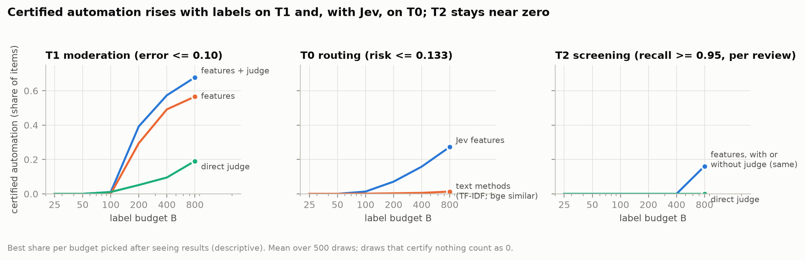
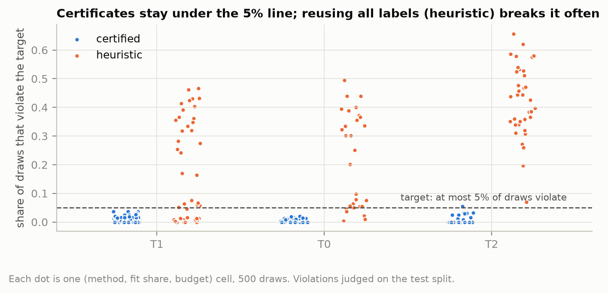

<div align="center">

# ldj · Low-Data Judgment

**How much can you safely automate with a few hundred human labels?**

[](https://github.com/dantedeprenda/ldj/actions/workflows/ci.yml)


[**Quick start**](#quick-start) · [**The tool**](#the-tool) · [**Findings**](#what-we-found) · [**Technical report**](docs/report.md) · [**Methods & limits**](docs/methods.md)

</div>

---

A team has a model that scores items (comments to moderate, prompts to route, records to screen)
and can afford a few hundred human labels. `ldj` answers the operational question: **which items
can skip human review, with an error rate the team can defend?**

It does not guess a threshold from the training labels; that is optimistic, and in our tests it
broke its own error target in 16–66% of simulated audits. Instead it **certifies**. It holds back
a random audit sample the model never saw, and picks the loosest threshold whose error is
provably below the limit at 95% confidence. If the evidence isn't there, it says so.

<p align="center">
  
</p>

## Quick start

No API key, no dataset download, no GPU. Needs [uv](https://docs.astral.sh/uv/).

```bash
git clone https://github.com/dantedeprenda/ldj.git && cd ldj
uv sync --extra dev
uv run ldj reproduce --fixture moderation-v1    # replay a pre-registered result, check every number
```

Then audit your own system:

```bash
uv run ldj audit predictions.csv --kind accept --alpha 0.10 --html report.html
```

An audit that cannot yet support the target says so, and says what is missing
([`examples/out/audit.md`](examples/out/audit.md), synthetic data):

```text
Verdict: insufficient evidence. Target: error rate among automated items <= 0.1, with
probability >= 0.95 over the draw of the audit sample (policy: accept).
- Audit sample: 121 labeled items; deploy items: 1036.
- Certifying risk <= 0.1 needs at least 29 audit items in the automated region with no
  errors (more if any are wrong); the first threshold tested holds 53 audit items.
```

A supported verdict gives the threshold, the certified bound and the share of deploy items it
automates.

## The tool

| Command | What it answers |
|---|---|
| **`ldj audit`** | *Can this frozen system run unreviewed?* Certifies an automation threshold from a random audit sample at an error or recall target, or says "insufficient evidence". HTML, Markdown and JSON reports. |
| **`ldj bridge`** | *Does escalating to a fallback actually help?* For cases where both outcomes are known: the four cells (both right, only default right, only fallback right, both wrong), the value of escalating, and escalation policies at fixed rates against random and an oracle. |
| **`ldj recommend`** | *How should I spend my label budget?* Turns a budget into a plan (which method, how much to fit vs certify), or "collect more labels first". |
| **`ldj split`** | *Is my evaluation leak-free?* A chronological split that never lets a group (an order, a shipment) straddle the boundary, plus a random audit cohort. Flags information that arrived after the decision. |
| **`ldj reproduce`** | *Can I trust the numbers?* Replays a packaged result offline and checks every value. |

<details>
<summary><b>Input format for <code>ldj audit</code></b></summary>

| Column | Meaning |
|---|---|
| `score` | the system's score for every item (higher = more confident, or P(positive) for `classify`) |
| `role` | `audit` (a random, human-labeled sample, labeled after the system was frozen) or `deploy` (unlabeled items the policy will run on) |
| `label` | 0/1 human label, on `audit` rows only |

- `--kind accept` automates items with score ≥ λ (wrong when label = 0).
- `--kind classify` automates items far from `--cut` (default 0.5) as `score ≥ cut`.
- `--kind recall --target 0.95` auto-rejects low scores while keeping recall.
- `--delta` sets the confidence (default 0.05). `--md`, `--json` and `--html` save the report.

Full contract, including `ldj bridge` and `ldj split`: [`docs/input-contract.md`](docs/input-contract.md).

</details>

**What a certificate means.** Over independent random audit samples, the probability that the
procedure issues an unsafe certificate is at most δ (5% by default). Audits that issue nothing count
as safe, so this is not a promise about the share of *issued* certificates, and it says nothing
about any single item. It assumes:
- the audit rows are a random sample of what the policy will face;
- the system was frozen before they were labeled;
- deploy items come from the same source;
- the audit labels are the reference the target is stated against.

The tool cannot check these, and the report shows what happens when the last two fail.

**How it works.** Clopper–Pearson bounds with fixed-sequence testing over a threshold grid built
only from unlabeled deploy scores ([`src/ldj/certify.py`](src/ldj/certify.py)). Starting the grid at
twice the zero-error minimum lifts power from ~50% to 87–99% in simulation.

## What we found

Three public task families: content moderation (Measuring Hate Speech), LLM routing
(LLMRouterBench) and systematic-review screening (SYNERGY). Each result is marked
**pre-registered** or **exploratory**. Details and caveats are in the
[technical report](docs/report.md).

| | Finding | |
|---|---|---|
| 1 | **Few-label models rank well, but certifying costs labels.** On moderation, 13 yes/no LLM questions plus the LLM's own verdict certify **57% automation at a 10% error limit with 400 labels**. Below 200 labels almost nothing certifies, for any method. | exploratory |
| 2 | **It pays only at volume.** Counting every annotation behind every label, the best setup breaks even after ~2,900–4,000 items and saves ~35% of human checks at 10,000. | exploratory |
| 3 | **A certificate holds only for its labels and its source.** Certificates computed on majority-of-3 votes failed against the consensus labels (29% violations where 5% was allowed). A platform shift broke them in up to 31–37% of audits. | exploratory |
| 4 | **Escalating "hard-looking" cases barely beats random.** In LLM routing no escalation policy reliably beats always using the mid-priced model at equal cost. | exploratory |
| 5 | **The decision model matters more than the method.** On routing, text methods certify ~1%; the same protocol with Jev's question answers certifies 16–27%. | exploratory |
| 6 | **On 5,000 untouched comments, a rule frozen in advance kept its automation advantage** (+0.417 over the LLM verdict alone), **but its guarantee check failed** on the pre-registered split. Over 20 re-drawn splits the guarantee held at 200–400 labels and was slightly exceeded at 800. | **pre-registered** |

The failure in finding 6 is reported as prominently as the successes. Every number traces to a
file in [`results/`](results/) (see its [README](results/README.md)), and corrections are listed in
[`docs/errata.md`](docs/errata.md).

<p align="center">
  
</p>

## Reproducibility

- **Offline replay.** `ldj reproduce --fixture moderation-v1` rebuilds the pre-registered
  moderation analysis and an audit demo from packaged labels, costs and predictions (no texts).
  `moderation-v2` does the same for the default rule. Step-by-step guide:
  [`REPRODUCE.md`](REPRODUCE.md).
- **CI.** Every push installs from scratch on Linux and runs the lint, the tests and the replay.
- **Pre-registration.** Hypotheses, the default rule and its confirmatory test were pushed before
  their data were scored. They are in [`preregistration/`](preregistration/) with their time
  stamps, and the three deviations are logged in
  [`deviations.md`](preregistration/deviations.md).
- **Full reruns.** Configs for every experiment are in [`configs/`](configs/). LLM calls are cached,
  and `max_usd` in a config is a hard cap on new spend. The language-model spend for the
  pre-registered runs was $5.52.

<details>
<summary><b>Running the experiments</b></summary>

```bash
uv sync --extra dev --extra embeddings
cp .env.example .env                           # OPENROUTER_API_KEY for LLM methods

# Moderation downloads itself; screening needs SYNERGY built once:
(mkdir -p data/t2 && cd data/t2 && ../../.venv/bin/synergy get -l -o synergy)
uv run ldj run configs/t1.yaml

# Allocation benchmark: 500 simulated audits per cell
uv run python scripts/allocate.py configs/x4_t1.yaml --workers 6        # local processes
uv sync --extra cloud && uv run modal token new                          # optional: cloud CPUs
uv run python scripts/modal_upload.py
uv run modal run scripts/modal_app.py --config configs/x4_t2.yaml
```

The routing task (T0) is exported from the companion routing repository,
[`routing-success-prediction`](https://github.com/dantedeprenda/routing-success-prediction), with
`scripts/export_t0.py`. The parallel and cloud runners give the same rows as the sequential one:
the same decisions, and thresholds within ~1e-4 across CPU architectures.

</details>

## Repository layout

```
src/ldj/          certify, audit, bridge, recommend, split, reproduce; task loaders and methods
configs/          one config per experiment (x4_* = allocation benchmark, w5_* = confirmatory test)
scripts/          analyses, ledgers, figures, parallel and cloud runners
results/          evidence tables behind every reported number
preregistration/  pre-registrations, the frozen default rule and the deviations log, verbatim
release/          packaged fixtures for offline replay; evidence manifest with hashes and licences
docs/             technical report, methods, input contract, pilot protocol template, errata
examples/         synthetic worked examples of audit, bridge and split
tests/            unit and end-to-end tests (no data, keys or network needed)
```

## Data, models and terms

Licences and terms re-checked on 2026-10-24.

| Resource | License / terms | In this repository |
|---|---|---|
| [Measuring Hate Speech](https://huggingface.co/datasets/ucberkeley-dlab/measuring-hate-speech) (Kennedy et al., 2020) | CC-BY-4.0 | downloaded by the loader; fixtures hold labels and derived predictions only |
| [SYNERGY](https://github.com/asreview/synergy-dataset) | labels CC0; abstracts from OpenAlex and publishers | ids and derived results only; abstracts are not redistributed |
| [LLMRouterBench](https://huggingface.co/datasets/NPULH/LLMRouterBench) | MIT (stated in its [README](https://github.com/ynulihao/LLMRouterBench); the repository has no LICENSE file) | derived results only |
| [TwinRouterBench](https://huggingface.co/datasets/Amorph/TwinRouterBench) | Apache-2.0 | derived results only |
| TypeSafe Jev (`jev-1.13.0`) | [Master Customer Agreement](https://typesafe.ai/legal/mca) | derived results only; raw answers are not redistributed |
| Gemma 4, Llama 3.3 (via OpenRouter) | model terms | derived results only |

**Disclosure.** The author has no affiliation with TypeSafe and received no compensation or free
access. AI coding assistants were used during development. The blind label audits were proposed by
an LLM and checked by the author, as logged in
[deviation 2](preregistration/deviations.md).

## Citation

See [`CITATION.cff`](CITATION.cff).

```bibtex
@software{deprenda2026ldj,
  title  = {ldj: Low-Data Judgment},
  author = {de Prenda, Dante},
  year   = {2026},
  url    = {https://github.com/dantedeprenda/ldj}
}
```

## License

Code: [Apache-2.0](LICENSE), copyright 2026 Dante de Prenda. Datasets and model outputs keep their
own terms (table above).
