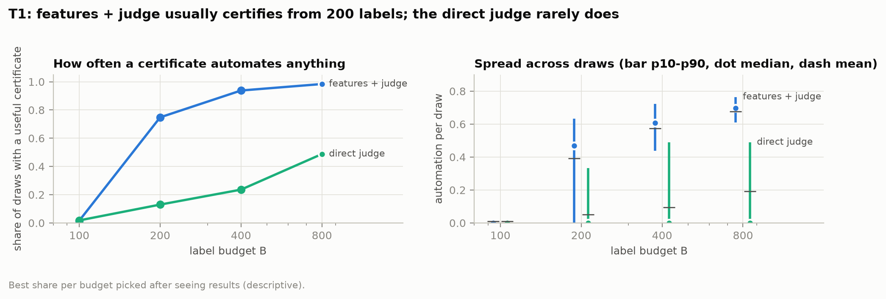
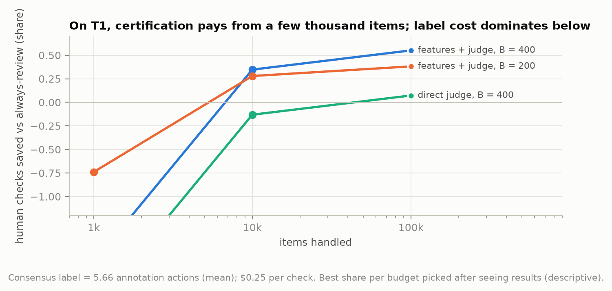
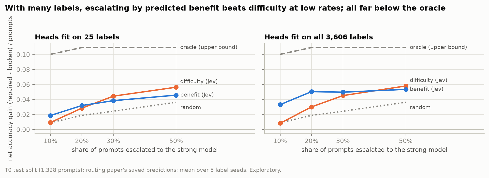
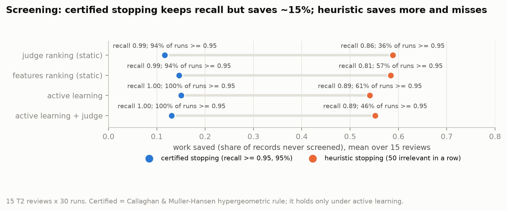
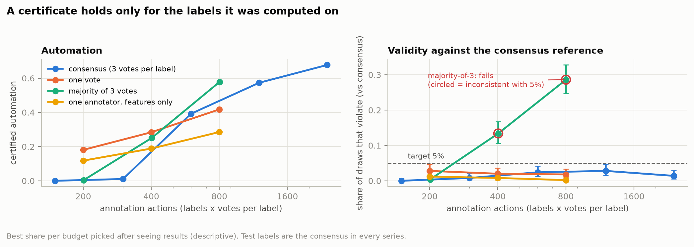

# Low-Data Judgment: how much can you safely automate with a few hundred human labels?

*Technical report, preview draft (ldj v0.1.0); results as of 2026-09-30. Every number below is
traceable to a file in this repository; paths are given in brackets. Results marked **exploratory** use data that had already been seen;
results marked **pre-registered** were fixed in a committed document before the data were scored.*

## 1. Summary

**The question.** A team has a model that scores items (comments to moderate, prompts to route,
records to screen) and a small budget of human labels, a few hundred at most. How much of the
work can it hand to the model while *knowing*, not hoping, that the error stays below a stated
limit? And how should the labels be split between training the model and checking it?

**What was built.** `ldj` is a small open tool (Apache-2.0) that answers this for a team's own data:
- `ldj audit` certifies an automation threshold from a random audit sample, or says "insufficient
  evidence";
- `ldj bridge` measures whether sending cases to a fallback actually helps;
- `ldj recommend` turns a label budget into a plan;
- `ldj split` builds time-ordered, leak-free evaluation splits;
- `ldj reproduce` replays the evidence offline.

It was validated on three public task families: content moderation, LLM routing and
systematic-review screening.

**Findings that matter most.**
1. **Few-label methods rank well, but certifying them costs labels.** On moderation, a model built
   from LLM answers to 13 yes/no questions plus the LLM's own verdict certifies **57% automation at
   an error limit of 10% with 400 labels** (a useful certificate in 94% of simulated audits). Yet
   **nothing certifies below 200 labels**, for any method. [results/x4_t1/summary.md; results/x4_t1_arms2/summary.md]
2. **Certification pays only at volume.** Counting every annotation behind every label, the best
   setup breaks even after **~2,900–4,000 items** and saves **~35% of human checks at 10,000
   items**. At 1,000 items it always loses. [results/ledger_t1.md; docs/errata.md]
3. **Rules that reuse the training labels to set thresholds are unsafe.** They break their own
   error target in **16–66%** of simulated audits. The certified rule stayed within its 5% budget
   in almost every cell; known-truth simulations trace the exceptions (§5, §6) to finite test sets
   and single fixed pools, not to a bug. [results/x4_*/summary.md; results/sim_violations/summary.md]
4. **A certificate holds only for the labels and the source it was computed on.**
   - Majority-of-3 votes produced certificates that failed against the consensus labels (**29%**
     violations at the largest budget).
   - Certifying on one platform and deploying on another failed in up to **31–37%** of audits,
     and more labels made it worse.

   [results/x4_t1_votes_maj3/summary.md; results/shift_t1/summary.md]
5. **Escalating "hard-looking" cases barely beats random.** In LLM routing, escalating by
   predicted difficulty helps about as much as escalating at random. No escalation policy reliably
   beats simply always using the mid-priced model at equal cost. [results/bridge_t0/equal_cost.md]
6. **The decision model matters more than the method.**
   - On routing, text methods certify ~1% of prompts. The same protocol with Jev's question answers
     certifies **16% (400 labels) to 27% (800 labels)**.
   - On screening, random-sample certification fails almost everywhere. The field's own workflow
     (active learning with a statistical stopping rule) met 95% recall in every tested run and
     saved ~15% (empirical, not a proven guarantee; §4.3).

   [results/x4_t0_arms2/summary.md; results/w7_t2/summary.md]

**Honest caveat.** Almost all of this is exploratory on data the author had seen. The confirmatory
test on 5,000 untouched comments (§6) replicated the rule's automation advantage (H1, H2), but its
pre-registered guarantee check (H3) failed on the pre-registered split. An exploratory follow-up
over 20 splits shows the guarantee holding at 200–400 labels and slightly exceeded at 800. An
independent human reproduction is scheduled but not yet done.

## 2. The problem

Teams usually judge a few-label model by ranking quality (AUROC): does it put the bad items above
the good ones? That is not the operational question. The operational question is *which items can
skip human review*, with an error rate the team can defend.

Answering it needs a threshold, and a threshold chosen on a few hundred labels is optimistic: the
labels that trained the model make it look better than it is. Thresholds set from 25 labels
reached recall 0.88 against a 0.95 target on screening, and risk 0.165 against 0.140 on routing.
[results/t2/analysis.md; routing: the companion routing paper]

The alternative is to **certify**: hold back a random sample of labels the model never saw, and
pick the loosest threshold whose error is provably below the limit (with 95% confidence) on that
sample. That turns a label budget into a trade-off. Labels spent training make the model better;
labels spent certifying make the guarantee possible. This project measures that trade-off across
three task families, builds it into a tool, and tests where it breaks.

Two pieces of arithmetic set the scene [src/ldj/certify.py, `min_accepted`]:
- To certify an error rate of at most 10% at 95% confidence, at least **29** audited items must
  fall in the automated region with **no** errors.
- To certify 95% recall at 95% confidence, you need **59** relevant items in the audit sample with
  none missed. At screening prevalence (a few percent), that is roughly a thousand labels per
  review.

## 3. The tool

| Command | What it does |
|---|---|
| `ldj audit predictions.csv --kind classify --alpha 0.10` | Certifies one frozen system from a random audit sample. It gives the automation threshold and share and the certified bound, or "insufficient evidence" with what would help. HTML/JSON report. |
| `ldj bridge paired.csv --score COL` | For cases with *both* outcomes known (default action and fallback): the four cells (both right, only default right, only fallback right, both wrong), the value of escalating, and escalation policies at fixed rates against random and an oracle. |
| `ldj recommend --task classify --budget 400` | Encodes the frozen default rule (§6): which method, how to split the budget, or "collect more labels first". |
| `ldj split events.csv --time T --group G` | Chronological development/evaluation split that never lets a group (an order, a shipment) straddle the boundary, plus a random audit cohort. Flags information that arrived after the decision. |
| `ldj reproduce --fixture moderation-v1` | Offline replay of a packaged result; no key, no download. |

[README.md "Tool"; docs/input-contract.md; src/ldj/]

**What a certificate means.** Over independent random audit samples, the probability that the
procedure issues an unsafe certificate (true error among automated items above α, or recall below
the target) is at most 5%. Audits that issue nothing count as safe, so this is **not** a promise
that 95% of *issued* certificates are safe: when certificates are rare, a larger share of issued
ones can be unsafe (T2, 800 labels: 2.5% of all audits vs 7.6% of issued certificates). It says
nothing about any single item. *(Corrected after an external review; see docs/errata.md.)*

**How it works.** Clopper–Pearson bounds with fixed-sequence testing over a threshold grid built
only from *unlabeled* deploy scores. The grid starts at twice the zero-error minimum, which lifted
power from ~50% to 87–99% in simulation. [docs/methods.md; src/ldj/certify.py]

**What it assumes, and cannot check:**
- the audit rows are a random sample of what the policy will face;
- the system was frozen before they were labeled;
- deploy items come from the same source;
- the audit labels are the reference the target is stated against.

§5 shows what happens when the last two fail. [src/ldj/audit.py, ASSUMPTIONS]

## 4. Evidence by task

The allocation benchmark works as follows:
1. Draw a label budget B, 500 times over.
2. Split it between fitting (share f) and a random certification sample.
3. Certify, then score the chosen threshold on a held-out test set.

All allocation-benchmark results are **exploratory**. Best-per-budget choices were read off after seeing test
results and are descriptive, not deployable. [results/README.md]

*Figure 1. Certified automation vs label budget. [docs/figures/fig1_frontier.png; scripts/figures.py]*

### 4.1 Content moderation (T1, Measuring Hate Speech)

**Pre-registered ranking results.** Question features (Gemma answering 13 yes/no questions, with a
logistic head) beat the best text baseline:
- at 25 labels, within-platform AUROC 0.869 vs 0.782, difference **+0.087 [+0.046, +0.136]** (H1);
- at 10 labels, +0.076 [+0.023, +0.118] (H2);
- cheaper per item, −$0.124 [−0.203, −0.042] (H3).

All three held when items a blind audit disputed were removed.
[results/t1/analysis.md; results/t1/analysis_audit.md; preregistration/T1.md]

**Certification (error ≤ 0.10, exploratory).**

| Method | B = 200 | B = 400 | B = 800 | B = 1,600 |
|---|---|---|---|---|
| Features + LLM verdict, f = 0.25 (0.50 at 800) | 39.3% (useful in 75%) | 57.4% (94%) | 67.8% (98%) | 73.7% (100%) |
| Features alone | 29.5% (59%) | 49.2% (86%) | 56.6% (87%) | – |
| Direct zero-shot LLM verdict (f = 0) | 5.1% | 9.5% | 19.1% | – |

- Nothing certifies at B ≤ 50 for any method; at B = 100 only the direct verdict certifies, 1.1%.
- The best split trains on a minority of the labels.
- The pre-registered best text baseline (bge-large embeddings) is never among the top certified
  arms.

[results/x4_t1/summary.md; results/x4_t1_arms2/summary.md; results/x4_t1_b1600/summary.md]

"Useful" matters, because the mean hides draws that certify nothing. At B = 200 with features
alone, the honest reading is "about a 60% chance of certifying ~40%", not "29% automation".

*Figure 2. Share of audits with a useful certificate, and the spread of automation.
[scripts/figures.py]*

**Target sensitivity.** The error limit drives everything:
- at α = 0.05, features + verdict certify 0 / 24.7% / 38.7% (B = 200/400/800);
- at α = 0.21 (no worse than one human reviewer), 80.9% / 92.6% / 98.7%.

Fixed-sequence selection beats Bonferroni at every budget (39.3% vs 8.8% at B = 200).
[results/x4_t1_alpha005/, x4_t1_alpha021/, x4_t1_bonf/ summaries]

**Whole-workflow cost (corrected).** This charges every annotation behind each consensus label
(5.66 on average), $0.25 per human review, and model calls. [results/ledger_t1.md; scripts/ledger.py]

| Features + verdict | Break-even | Checks saved @1k | @10k (share of audits that save) | @100k |
|---|---|---|---|---|
| B = 200, f = 0.25 | 2,884 items | −73.9% | +27.9% (75%) | +38.1% |
| B = 400, f = 0.25 | 3,948 items | −169% | +34.7% (92%) | +55.1% |
| B = 800, f = 0.50 | 6,681 items | −385% | +22.5% (97%) | +63.2% |

The direct LLM verdict breaks even only after 22,000–53,000 items.

*Figure 5. Human checks saved vs always-review, by volume (corrected ledger). [scripts/figures.py]*

**Correction.** An earlier version of this ledger counted a consensus label as 3 annotations and
overstated savings; a code review caught it. One claim was withdrawn: "consensus labels are
cheaper per annotation than single labels". Per annotation, one annotator is slightly cheaper
(20.5% vs 18.1% saved at 10k). [docs/errata.md; preregistration/default-rule.md, Erratum]

### 4.2 LLM routing (T0, LLMRouterBench; T0b, TwinRouterBench)

Here "automating" means answering with the cheap model instead of the strong one. The error limit
was fixed before any result, at half the always-accept failure rate on the training pool
(α = 0.1331). [configs/x4_t0.yaml]

- **Text methods fail.** At most 1.3% certified at B = 800 (TF-IDF, embeddings, category prior),
  and their rare certificates are unreliable: 6–100% of *issued* certificates violate, though the
  unconditional rate stays within budget.
- **Jev question features work.**
  - 7.1% at B = 200, **15.8%** at B = 400 (useful in 42%), **27.3%** at B = 800 (useful in 66%).
  - Issued certificates violate in only 2–3%.
  - The routing paper's ranking advantage (AUROC 0.73 vs ≤ 0.66) becomes certified automation the
    text methods cannot reach.
  - At α = 0.10 it drops to 10.5% at B = 800; at α = 0.20 it rises to 63.7%.
- **Money.** At B = 400: $0.0213 per prompt vs $0.0251 always-strong, about $37 saved per 10,000
  prompts (in 42% of audits). At B = 800: about $64. This is a cost–quality trade (automated
  prompts carry the cheap model's certified risk), not a free saving. [results/ledger_t0.md]
- **A pre-declared success criterion** ("≥ 10% certified automation at ≤ 800 labels on ≥ 2
  tasks") **failed** with the pre-declared text methods and **passes** once Jev is added. Both
  readings are reported because Jev was added after the verdict. [results/x4_t0/summary.md;
  results/x4_t0_arms2/summary.md]
- **TwinRouterBench replication** (α = 0.1450, fixed first): a category prior alone certifies
  about half the prompts (49.4% at B = 200), and Jev adds nothing over it. That matches the
  routing paper's finding that categories are highly informative there.
  **Caveat:** TwinRouterBench records only each prompt's cheapest sufficient model tier, not
  measured outcomes for every model, so outcomes are *simulated from tiers* and the top tier is
  right by construction. These results are not paired-execution evidence like LLMRouterBench's.
  [results/x4_t0b/summary.md; configs/x4_t0b.yaml]

**Escalation (exploratory).** Every LLMRouterBench prompt has both models' outcomes. On
the test split: both right 927, only cheap right 58, only strong right 145, both wrong 198.
Escalating everything is worth +6.6 points at ~22× the cost. [results/bridge_t0/report.md]

- **Difficulty:** escalating the top 10% by predicted difficulty nets −0.005 to +0.012 (random:
  +0.009). It sends prompts that are hard for both models.
- **Benefit:** escalating by predicted benefit (P(strong right) − P(cheap right)) nets +0.029 to
  +0.035 with all labels, but only +0.008 to +0.019 with 25 labels per model. The oracle nets
  +0.100.
- **At equal cost, against always using the mid-priced model:**
  - difficulty escalation is worse for every router;
  - benefit escalation is at most slightly better (+0.008 to +0.020; one of four intervals excludes
    zero, uncorrected, on seen data);
  - on TwinRouterBench (tier-simulated outcomes, see above) every policy, the oracle included,
    loses to the fixed mid-tier models.

  [results/bridge_t0/equal_cost.md; results/bridge_t0b/]

*Figure 7. Net repair by escalation rate. [scripts/figures.py]*

### 4.3 Systematic-review screening (T2, SYNERGY)

**Pre-registered ranking results.** Question features beat the best text baseline:
- +0.058 [+0.008, +0.103] AUROC at 25 labels;
- +0.077 [+0.049, +0.111] at 10;
- more work saved at 95% recall in all 5 label draws (WSS@95 0.521 vs 0.332).

[results/t2/analysis.md; preregistration/T2.md]

**Random-sample certification fails.**
- Nothing certifies 95% recall at B ≤ 400 in any of the 15 reviews.
- At B = 800 only 3 reviews can even afford the budget, and one certifies: Moran_2020, whose
  certification samples hold ~70 relevant records. The others hold 4–14.
- Treating the review as the unit, mean automation is 0.161 **[0.000, 0.484]**: nothing
  generalizes.
- Loosening to 90% recall barely helps.
- In total, one review saves 577 screening decisions (3.8% of 15,121 records).

[results/t2_reviews.md; results/ledger_t2.md]

**Screening the way the field does it (exploratory).**
- Active learning with the Callaghan & Müller-Hansen stopping rule reached 95% recall in
  **every** tested run of every review, saving ~15% of screening. This is empirical: the rule
  tests many windows repeatedly, a multiple-testing issue its source paper leaves open, so it is
  not a proven guarantee.
- Static LLM rankings broke the rule's assumption and stopped too early in 7–8 of 15 reviews.
- Heuristic stopping saved 54–59% but missed 95% recall in 39–64% of runs.
- Adding the LLM to active learning did not help.

[results/w7_t2/summary.md; results/w7_t2/per_review.md]

*Figure 6. Work saved vs recall by workflow and stopping rule. [scripts/figures.py]*

## 5. When certificates fail

*Figure 3. Certified cells stay near the 5% line; heuristic thresholds do not. [scripts/figures.py]*

**The label definition.** At equal annotation effort:
- certificates computed on one annotator's votes stayed valid (conservative, because the extra
  noise is random);
- certificates computed on the **majority of 3 votes failed against the consensus**: 13.4%
  [10.5, 16.7] violations at ~400 annotations and 28.6% [24.7, 32.8] at ~800, against a 5% budget.

Majority voting removes random disagreement but not the gap between a raw vote and the consensus
score. The model learns the voters' lean, and the certificate measures error against the same
voters. [results/x4_t1_votes_one/summary.md; results/x4_t1_votes_maj3/summary.md]

*Figure 4. Certificates hold only for the label definition they were computed on.
[scripts/figures.py]*

Related: certifying with one annotator's labels instead of the consensus kept every certificate
valid but automated about half as much (e.g. 18.9% vs 49.2% at B = 400).
[results/x4_t1_single/summary.md]

**The source.** Certifying on one platform's comments and deploying on another's broke
certificates in one direction: from platform 2 (24% hateful) to platforms 0 or 3 (~31%).
- Violations reached 9–11% at B = 200, 12–18% at 400, and **31–37% at 800**. More labels made it
  worse.
- Using the new platform's unlabeled scores to set the thresholds did not help; only labels from
  the new source would.
- Same-platform controls stayed valid.

[results/shift_t1/summary.md; scripts/shift_analyze.py]

**Simulation limits.** Known-truth simulations (synthetic data with known risk, the real code path)
found **no implementation error**: judged on true risk, violations stayed ≤ 3.7%. Finite test sets
inflate measured violations to ~6–7% near α, and single fixed pools vary widely (17–26% of valid
pools exceed 5%). That reproduces the flags below; the confirmatory test's 800-label excess is only
partly reproduced. [results/sim_violations/summary.md; scripts/sim_violations.py]
- At α = 0.21, one cell showed 8.0% violations, but only 2 of its 40 exceeded α by more than 1.96
  test-set standard errors. Violations are judged on a finite test split, which overstates them
  when certified risk sits near α. [results/x4_t1_alpha021/summary.md]
- The confirmatory test's pre-registered split (§6) is one such single-pool run; over 20 re-drawn splits the rates
  fall to 3.0% / 4.5% / 6.6%.
- On TwinRouterBench, 7 of 100 cells (embeddings, B = 400) flagged. With 400 labels drawn from a
  500-prompt pool, resamples are nearly identical and no longer mimic independent audits.
  [results/x4_t0b/summary.md]

## 6. Confirmatory test on fresh data

**Result (pre-registered).** H1 and H2 are supported; H3 is **not**. [results/w5_t1_fresh/w5.md;
preregistration/W5.md]

| Hypothesis | Result | Verdict |
|---|---|---|
| H1: rule > direct LLM verdict at B = 400 | 61.5% vs 19.8%, +0.417 [+0.395, +0.439] | supported |
| H2: rule > fixed 50/50 split at B = 400 | 61.5% vs 47.0%, +0.145 [+0.124, +0.167] | supported |
| H3: guarantee holds at every B | violations 7.2% / 16.6% / 19.4% at B = 200 / 400 / 800 | **not supported** (excess violations detected) |

The rule's automation advantage replicated on untouched data. Its guarantee did not, on the
pre-registered split.

An **exploratory** follow-up explains most of the gap:
- That split's test half happened to be harder than its pool (28.7% vs 26.5% hateful).
- All 500 simulated audits share that one pool.

Re-drawing the pool/test split of the same comments 20 times [results/w5_splits_summary.csv] gives pooled violation rates of
**3.0% [2.3, 3.8], 4.5% [3.6, 5.5] and 6.6% [5.6, 7.8]**. So the guarantee holds at 200 and 400
labels, and is slightly exceeded at 800, partly test-set noise; a real small excess is not
excluded.

Two lessons follow:
- Single-split simulations can overstate violations.
- The largest budget deserves caution.

**The rule.** It was frozen from the development results above [preregistration/default-rule.md]:
- questions + LLM verdict;
- no certification below 200 labels;
- fit on 25% of the budget up to 400 labels, and 50% from 800;
- consensus labels.

**The test.** The rule is tested unchanged on **5,000 Measuring Hate Speech comments never used
before**. They have zero overlap with the 5,000 development comments, and the development
selection is reproduced exactly. The pre-registration, rule and analysis script were pushed
before any answer for these comments existed. [preregistration/W5.md; scripts/w5_analyze.py]

| Hypothesis | Supported if |
|---|---|
| **H1 (primary):** at B = 400 the rule automates more than the direct LLM verdict | paired 95% interval over 500 audits excludes 0 |
| H2: at B = 400 the rule automates more than a fixed 50/50 split with features alone | same |
| H3: the rule's guarantee holds at B = 200, 400 and 800 | Clopper–Pearson interval of the violation rate reaches ≤ 0.05 (a pass would only mean "not contradicted by this test") |

Development-data values, for reference, not criteria: 57.4% for the rule at B = 400, 9.5% for the
direct verdict, 44.5% for the fixed split.

## 7. Models and cost

**Latency per call** (from the call cache, not a controlled benchmark)
[results/latency.md]:

| Model | Median | p95 |
|---|---|---|
| Jev | 0.28 s | 0.39 s |
| Llama 3.3 70B | 0.90 s | 3.54 s |
| Gemma 4 26B | 1.50 s | 6.93 s |

**Terms of use.**
- Jev: using its answers as features was checked against TypeSafe's customer agreement and judged
  permitted. §2.3 forbids distillation, imitation of outputs, or competing products, and outputs
  belong to the customer. Raw Jev outputs are not published.
  [TypeSafe Master Customer Agreement](https://typesafe.ai/legal/mca)
- Gemma: Google claims no rights in outputs. [release/MANIFEST.md]

**Model and question comparisons on T1** (exploratory, same draws). Best certified automation at
α = 0.10. [results/x4_t1_jev/, x4_t1_llama/, x4_t1_blind/, x4_t1_judge5/ summaries]

| Method | B = 200 | B = 400 | B = 800 |
|---|---|---|---|
| Gemma features + verdict (the frozen rule) | 39.3% | 57.4% | 67.8% |
| **Jev** question features + Jev verdict | **47.2%** | **65.8%** | **73.0%** |
| Llama 3.3 70B features + verdict | 41.7% | 59.2% | 67.0% |
| Blind questions (task description only) + Gemma verdict | 38.2% | 56.5% | 65.8% |
| Gemma verdict alone, one answer | 5.1% | 9.5% | 19.1% |
| Gemma verdict alone, mean of 5 samples | 9.8% | 22.9% | 35.4% |
| Llama verdict alone | 16.5% | 28.1% | 32.7% |

- **The method isn't tied to one model or one question set:**
  - Llama matches Gemma;
  - questions written blind (deviation 3) do as well as the author's, so overlap with the survey
    items does not explain the result.
- **Jev's question features certify the most**, at ~2.2× lower cost per comment than Gemma's.
  Jev as a *direct* verdict is weak (3.2% at B = 400).
- **The verdict alone is limited by coarse scores:** averaging 5 sampled answers doubles what it
  certifies. Inside features + verdict it adds nothing.
- **Repeatability:** repeat calls to Jev change its probability by ~0.012 on average, and flip 2%
  of decisions. [results/x4_t1_jev_repeat/summary.md]

**Money.**
- Language-model spend for the pre-registered runs was $5.52 (moderation $2.08, screening $3.44).
- Each later fetch is capped (`max_usd`) and logged.
- Simulations ran on cloud CPUs (Modal) under a free monthly credit.

## 8. Reproducibility

- **Offline replay.** `ldj reproduce --fixture moderation-v1` rebuilds the pre-registered T1
  analysis and an audit demo from packaged labels, costs and predictions (no texts), and checks
  every number. `moderation-v2` does the same for the features + verdict demo, which is supported
  at α = 0.10 with 1,000 audit labels (49% automated). [release/fixtures/; REPRODUCE.md]
- **CI.** Every push installs from scratch on Linux and runs the tests and the replay.
  [.github/workflows/ci.yml]
- **Simulated outsider check.** A fresh agent with no project context followed `REPRODUCE.md` in
  a clean clone and reproduced the result in ~5 minutes; its friction points were fixed. This is
  **not** an independent reproduction. One by an outside person is scheduled.
  [REPRODUCE.md]
- **Cloud vs laptop.** Simulation rows agree in every decision; thresholds differ by ≤ 2×10⁻⁴ on
  x86 vs ARM, and routing runs were identical. [scripts/modal_app.py]
- **Records.** Pre-registrations and risk targets were pushed before their data were scored (git
  timestamps). An evidence manifest hashes every data and result file with its licence
  [release/MANIFEST.md]. Three deviations are logged [preregistration/deviations.md]:
  - a restarted T2 run (no effect);
  - blind audits labeled by Claude and checked by the author;
  - the blind question set generated before its prompt was committed.

## 9. Limits and next steps

**Limits.**
- Almost everything except §4's pre-registered ranking results and §6 is exploratory on seen
  data; best-per-budget choices were picked after seeing results.
- Violations are judged on finite test splits (optimistic or pessimistic near α), and small pools
  make resamples dependent.
- Screening labels are abstract-stage decisions for 11 of the 15 reviews but final full-text
  inclusions for 4 (a mixed target); review pools were capped at 2,000 records.
- The blind audits of the development labels were done by Claude and checked by the author, not
  by independent annotators.
- Moderation questions overlap the survey items that define the label.
- Results hold on one corpus and do not transfer across platforms without a new audit (§5).
- Money figures use sourced but assumed review prices ($0.25 per comment, £1.18 per record).

**Next.**
1. A Jev-based version of the default rule (the strongest engine on T1 and T0), frozen and tested on
   fresh data with **several independent splits**, which §6 showed a guarantee check needs.
2. An independent reproduction by an outside person.
3. The first real use: a warehouse workflow (a recurring decision with a default action and a
   fallback), taken from historical data to a shadow pilot, with go/no-go criteria fixed before
   outcomes are seen. The tool side is ready [docs/input-contract.md;
   docs/pilot-protocol-template.md; examples/].
